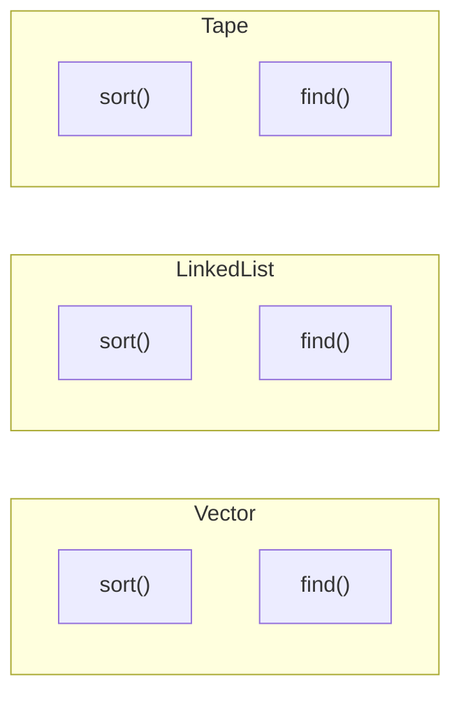
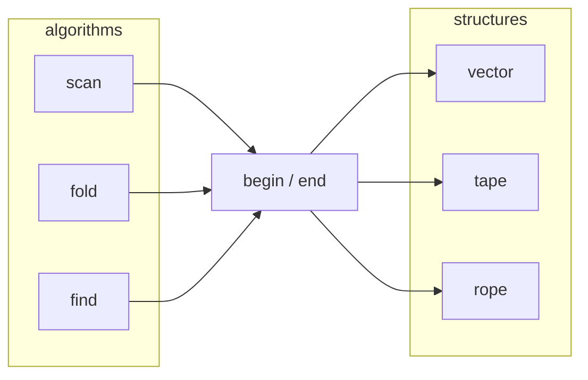
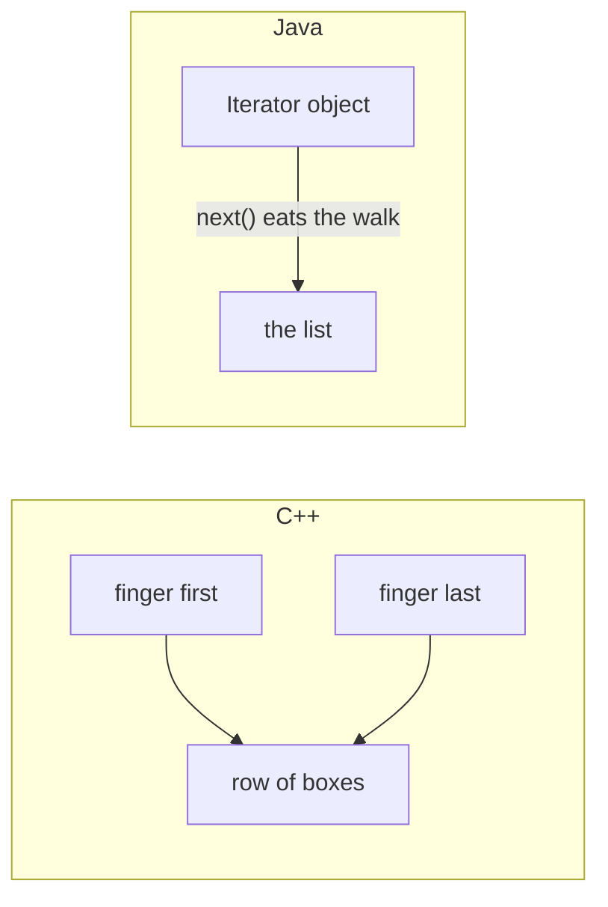

# Why `begin` / `end`

Algorithms walk iterators. Iterators sit on structure. That is cheaper than putting the algorithm on the class, as Java does.

Slower walkthrough with no jargon: [for kids and beginners](for-beginners.md).

## Java: the structure owns the algorithm

Each type grows its own methods.



Cost:

```
S structures × A algorithms = S·A
```

A new algorithm (`scan`) means a new method on every class. A new structure (`tape`) must reimplement `sort`, `find`, …

## STL++: `begin` / `end` are the connectors

The algorithm never names the structure.



Cost:

```
S + A
```

Each structure offers iterators once. Each algorithm is written once against an iterator concept (`forward`, `bidirectional`, `random_access`).

## Why a pair, not a Java `Iterator`

A C++ iterator is a **finger on an address**. A Java `Iterator` is a **little machine that hands you the next thing**. Those are not the same job.

**Coordinate (C++).** `begin` and `end` are two copies of a pointer-like value. Each one *is* a place: “box 0”, “just past the last box”. You can copy a finger and the copy still points at the same box. You can keep `first` and `last` at the same time. A subrange is just two fingers, not a new list. Counted walk is real: “move this finger *n* boxes” (`find_if_n`, `copy_n`). Distance is real: `last - first` on a contiguous row.

**Cursor object (Java).** `list.iterator()` builds an object with hidden state: “I am *currently* here.” `next()` **moves that object**. There is usually one such machine per walk. You do not get a cheap second finger at the old place — you call `iterator()` again and start from the front. You cannot hold `[first, last)` as two addresses, because Java does not give you the address of the box. The GC owns the objects; you get a handle, not a coordinate.



**Why the object iterator does not count**

- It is not a place, so `last - first` does not mean “how many boxes.”
- Copying it does not give you two independent fingers (the state lives *inside* the object).
- After the walk, the machine is spent. Next time you **reset** (new `iterator()`).
- Counted `_n` algorithms need “this finger, *n* steps, stop.” A cursor that only knows `hasNext` / `next` does not give you that pair.

So the machine is:

```
algorithm(first, last, op)    not    structure.algorithm()
```

Functors plug into the algorithm. The algorithm walks the iterators. The iterators sit on the structure. That is the `S+A` split. Java’s `S·A` is the class hierarchy doing the same job by copying methods.

`power` is the exception: functor + value, no iterator, no structure.
