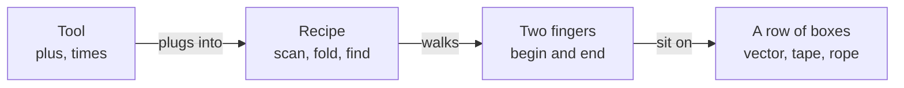

# The generic machine, for kids and beginners

STL++ is not a second box of toys. It is the *way the toys plug together*.

You already have a row of numbers (`vector`). You already have recipes in the standard library (`sort`, `find`). This library is the same idea, written so a recipe does not care which row it is looking at.

## Four parts



1. **Tool (functor)** — a tiny machine with one job. `plus` adds. `times` multiplies. `odd` says yes or no.
2. **Recipe (algorithm)** — “go along a row and do the tool.” `fold` boils the row down to one number. `scan` writes running totals. `find` stops at a match.
3. **Two fingers (iterators)** — `begin` points at the first box. `end` points just *past* the last box. The recipe only looks where the fingers point.
4. **A row of boxes (structure / layout)** — `vector`, `tape`, `rope`. Different shelves. Same kind of row if they offer `begin` and `end`.

The recipe never says “I only work on vector.” It says “give me two fingers and a tool.”

## One picture in code

```cpp
#include "stlpp.h"

std::vector<int> v{1, 2, 3, 4};

mt::fold(v, 0, mt::plus<int>{});  // 10   start at 0, add every box
mt::scan(v, mt::plus<int>{});     // {1, 3, 6, 10}  running totals
```

`plus` is the tool. `fold` / `scan` are the recipes. They walk from `begin` to `end` on `v`.

If `tape` also has `begin` and `end`, the *same* recipes work. You do not copy `fold` into a `Tape` class.

## Why that is easier

Bad way (like a Java list that has `.sort()` and `.find()` on the object):

- 3 kinds of row × 10 recipes = **30** copies of the work.

Good way (two fingers as the plug):

- 3 kinds of row + 10 recipes = **13**.

Write the recipe once. Teach each row to be pointable. That is the whole trick.

More on that, with the Java picture: [Why begin / end](begin-end.md).

## One recipe with no row

`power` is a recipe for a *value*, not a row. No fingers. No boxes.

```cpp
mt::power(2, 10, std::multiplies<int>{});  // 1024
```

Tool (`times`) plugs into the recipe. That is it.

## Words you will see later

| Grown-up word | Kid word |
| --- | --- |
| functor | tool |
| algorithm | recipe |
| iterator | finger / `begin`–`end` |
| layout / structure | row of boxes |
| counted `_n` | “only walk *n* boxes” |

You keep `std::vector` and `std::sort`. STL++ is extra recipes, extra tools, and extra rows (`tape`, `rope`, `zipper`) that still speak `begin` / `end`.
